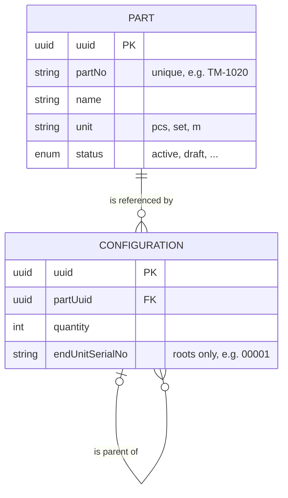
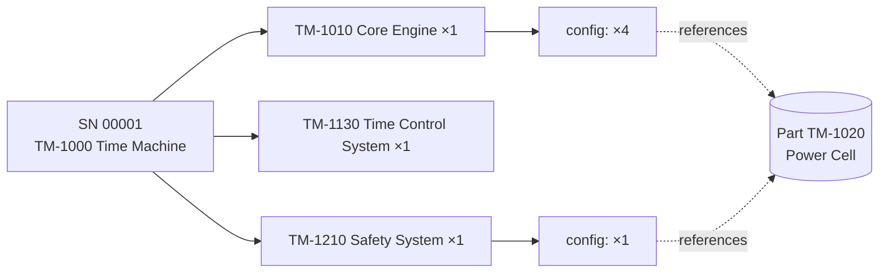
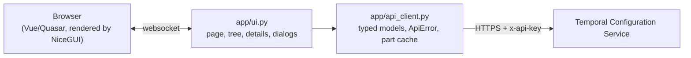
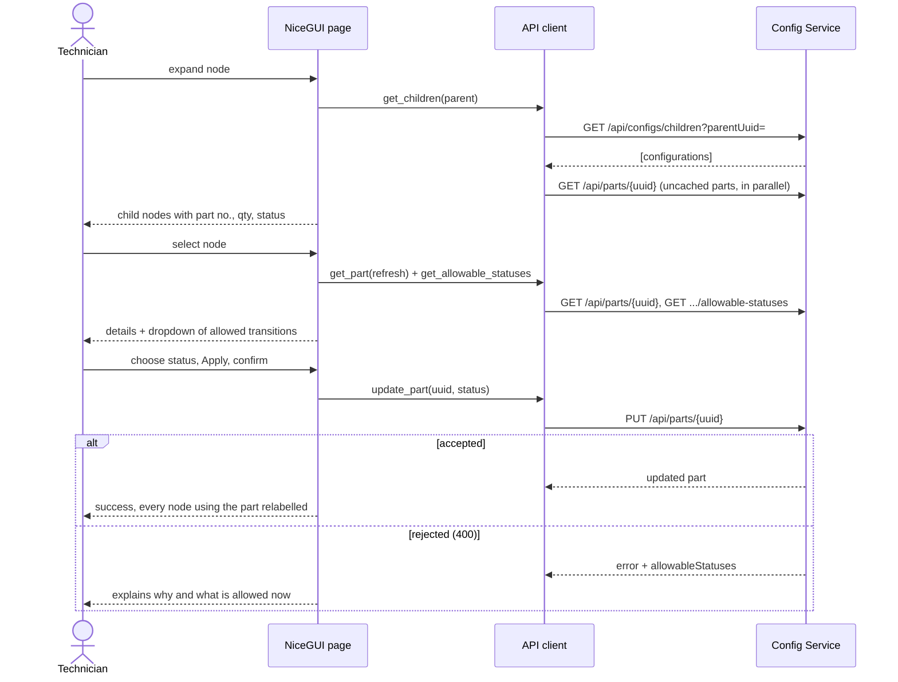

# Temporal Control Interface

A web interface for field technicians to browse time-machine configurations, inspect the parts they use, and change part status within the transitions the Temporal Configuration Service allows.

Built with **Python + [NiceGUI](https://nicegui.io)** (Vue/Quasar components driven from Python) and **httpx**.

## Quick start

```bash
python3 -m venv .venv
source .venv/bin/activate
pip install -r requirements-dev.txt
cp .env.example .env        # then set TM_API_BASE_URL and TM_API_KEY
python main.py              # open http://localhost:8080
pytest                      # unit tests for the API client
```

### Watching the API calls

The browser never calls the Configuration Service directly. The Python server does, which keeps the API key out of the browser. Because of that, the browser's DevTools Network tab shows only NiceGUI's WebSocket traffic. To see the real API calls, set `LOG_API=1` in `.env`. Each call is then printed in the terminal running `main.py`:

```
14:02:11  API  GET /api/configs/children -> 200 (188 ms)
14:02:15  API  GET /api/configs/children?parentUuid=164a377c-… -> 200 (121 ms)
14:02:15  API  GET /api/parts/b5a3bc73-… -> 200 (97 ms)
14:02:31  API  PUT /api/parts/b5a3bc73-… body={"status": "experimental"} -> 200 (143 ms)
```

Failed calls are always printed, even without `LOG_API`. The API key is never logged.

## What it does

| Requirement | How the interface meets it |
|---|---|
| Navigate the configuration hierarchy | Tree on the left. End units (serial numbers) are the roots; expanding a node loads its children on demand. Filter box searches loaded nodes. |
| Show part details | Selecting a node shows the referenced **part** (part number, name, status, unit, UUID) and the **configuration** itself (quantity, serial, component count). A breadcrumb shows where it sits in its time machine. |
| Update status within allowable transitions | The status dropdown lists only what `GET /allowable-statuses` returns. A confirm dialog warns that the part is shared. Rejected changes (HTTP 400) are shown with the statuses the service allows now. |
| Keep technicians in sync | A successful status change is pushed to every other open tab immediately. |
| Visualise relationships | Tree with icons, quantities and colour-coded status badges; breadcrumb path; "Same part is used in N other configurations" list that links to each usage. |
| Handle errors gracefully | All HTTP, network and timeout failures become one `ApiError` with a readable message, shown as a notification or an inline retry card. The page never crashes. A header chip shows API health. |

## Data model

A **Part** is a reusable blueprint. A **Configuration** is one concrete use of a part inside an assembly, with a quantity. Configurations nest into a tree; a root configuration is an *end unit*: a complete time machine with a serial number.



The same part appears in many places. For example, **TM-1020 Power Cell** is used ×4 in the Core Engine and ×1 in the Safety System of time machine 00001:



Because status lives on the **part**, changing it affects every configuration that uses that part across the whole fleet. The UI says so before it sends the change.

## API used

| Method | Path | Used for |
|---|---|---|
| GET | `/api/health` | Header status chip |
| GET | `/api/configs/children` | Root end units (no `parentUuid`) |
| GET | `/api/configs/children?parentUuid={uuid}` | Children when a node is expanded |
| GET | `/api/parts/{uuid}` | Part details (cached by UUID) |
| GET | `/api/parts/{uuid}/allowable-statuses` | Options for the status dropdown |
| PUT | `/api/parts/{uuid}` | Apply a status change |

## Architecture



- **The API key stays on the server.** The browser talks only to the NiceGUI server, so the key never reaches the client and cross-origin (CORS) rules don't apply.
- **`api_client.py` is the only module that knows HTTP.** It turns JSON into dataclasses (`Part`, `Configuration`, `AllowableStatuses`) and normalises the API's several error formats into one `ApiError`. It is unit-tested with `httpx.MockTransport`, so the tests need no network.
- **Lazy loading.** The tree fetches one level at a time, and part lookups for a level run concurrently. Parts are cached by UUID because many configurations share a part.
- **Fresh data where it matters.** Selecting a node re-fetches its part and its allowable statuses, because transitions can depend on the state of related parts.
- **Live updates across tabs.** When a status change succeeds, the server tells every other open tab (a simple publish/subscribe in `app/ui.py`). Their badges update, a related details panel refreshes, and a notice says the part was changed in another session. No technician is left looking at a status that has changed.

### Selecting a node and changing its status



## Project layout

```
main.py               entry point: loads .env, creates the client, registers the page
app/api_client.py     HTTP client, models, error normalisation, cache
app/ui.py             the interface
tests/                client unit tests (no network)
```

## Known limitations / next steps

- The API has no "list all parts" or "where used" endpoint, so "other usages" only covers nodes already loaded in the tree.
- Unit of measure is editable through the API but not yet in the UI.
- Live updates cover changes made through this server. Changes made elsewhere (Swagger, other systems) appear when a node is selected or the tree is reloaded. Covering those needs polling, or change events from the backend.
- Live updates and the part cache live in one server process. Running several processes would need a shared channel such as Redis pub/sub.
- Next additions: deep links to a serial number or part, keyboard navigation, and UI tests with NiceGUI's `User` test fixture.
